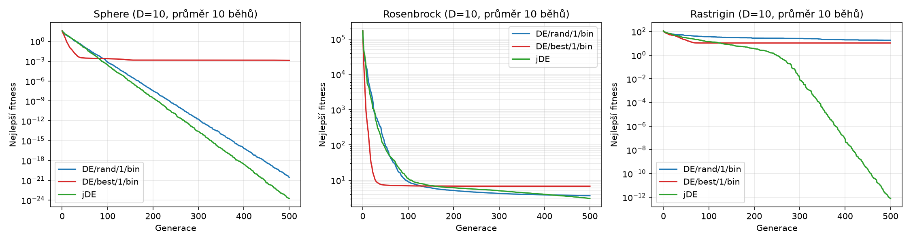
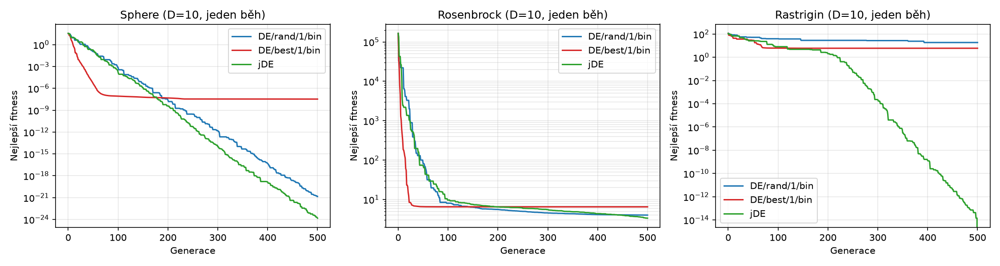
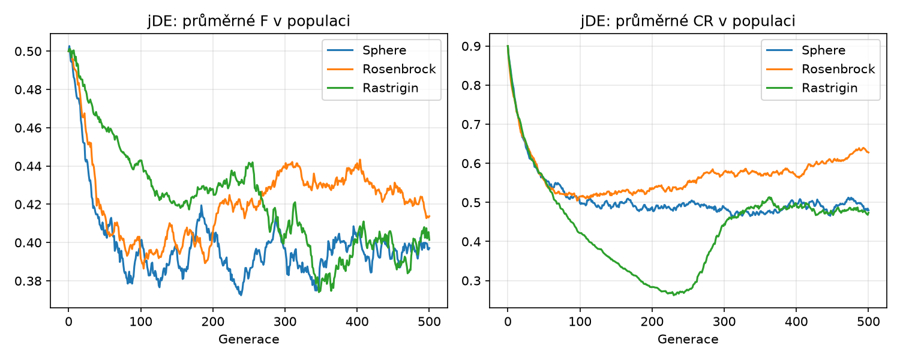

# Úkol 3 — Diferenciální evoluce: DE/rand/1/bin, DE/best/1/bin a jDE

## 1. Zadání
Implementovat a porovnat tři varianty diferenciální evoluce (DE) a ukázat jejich
konvergenci na testovacích funkcích (minimalizace):

| Varianta      | Mutace                              | Parametry                                                        |
|---------------|-------------------------------------|------------------------------------------------------------------|
| DE/rand/1/bin | v_i = x_r1 + F(x_r2 − x_r3)         | CR = 0,8; F = 0,5                                                |
| DE/best/1/bin | v_i = x_best + F(x_r1 − x_r2)       | CR = 0,8; F = 0,5                                                |
| jDE           | Rand/1 (jako výše)                  | τ₁ = τ₂ = 0,1; CR ∈ [0, 1] (start 0,9); F ∈ [0,1; 0,9] (start 0,5) |

## 2. Teorie

### 2.1 Princip DE
DE (Storn, Price) je populační algoritmus pro spojitou optimalizaci. Populace
NP vektorů x_i ∈ ℝᴰ se vyvíjí po generacích; v každé generaci se pro **každého**
jedince i (cílový vektor) provede:

1. **Mutace** – vytvoří se mutační vektor v_i přičtením *váženého rozdílu* dvou
   vektorů populace k základnímu vektoru. Rozdíl vektorů automaticky přizpůsobuje
   délku kroku aktuálnímu rozptylu populace: populace daleko od optima dělá velké
   kroky, zkonvergovaná populace malé.
2. **Křížení (binomické, „bin")** – zkušební vektor u_i přebírá každou složku z
   v_i s pravděpodobností CR, jinak ji ponechá z x_i. Jedna náhodně vybraná
   složka (j_rand) se bere z v_i vždy, aby se u_i lišil od x_i (v obrázku ze
   zadání: „alespoň jeden prvek musí být ze šumového vektoru").
3. **Selekce** – u_i nahradí x_i, pokud f(u_i) ≤ f(x_i). Jde o jednoduchý
   elitismus: nejlepší fitness populace nikdy nezhorší.

Index r1, r2, r3 jsou navzájem různé a různé od i. Složky mimo rozsah úlohy se
nahradí náhodnou hodnotou z rozsahu.

### 2.2 Varianty
- **DE/rand/1/bin** – základ mutace je náhodný jedinec. Silná explorace, pomalejší
  konvergence, odolnost proti uvíznutí v lokálním optimu.
- **DE/best/1/bin** – základ mutace je nejlepší jedinec populace. Silná exploatace:
  všichni potomci vznikají kolem nejlepšího bodu → rychlý start, ale vyšší riziko
  předčasné konvergence (ztráta diverzity).
- **jDE** (Brest et al., 2006) – mutace Rand/1, ale F a CR si **nese každý jedinec**
  a samy se vyvíjejí. Před tvorbou zkušebního vektoru se parametry jedince
  s pravděpodobností τ přegenerují:

  ```
  F_i  = 0,1 + 0,8·rand   s pravděpodobností τ₁ = 0,1  (jinak F_i beze změny)
  CR_i = rand             s pravděpodobností τ₂ = 0,1  (jinak CR_i beze změny)
  ```

  Zkušební vektor se vytvoří s těmito (případně novými) hodnotami. **Pokud potomek
  uspěje** (nahradí rodiče), nové F_i a CR_i se zachovají; jinak se zahodí. Dobré
  hodnoty parametrů tak přežívají společně s dobrými řešeními a není třeba je
  ručně ladit.

## 3. Implementace ([de.py](de.py))
Python + NumPy, všechny operace vektorizované přes celou populaci.

- `run_de(variant, func, low, high, init_pop, rng)` – jedno jádro pro všechny tři
  varianty (`rand1`, `best1`, `jde`); liší se jen výběrem základního vektoru a
  zdrojem F a CR.
- `distinct_indices` – pro každého jedince i vybere navzájem různé indexy různé od i.
- `binomial_crossover` – binomické křížení s j_rand.
- Selekce `trial_fit <= fit` je synchronní (po vyhodnocení celé generace).
- Best/1 bere nejlepšího jedince z populace na začátku generace.

Spuštění (z adresáře `Ukol3`):
```bash
../.venv/bin/python de.py
```
Vytvoří `statistics.csv`, `convergence.png`, `convergence_single_run.png`,
`jde_parameters.png`.

## 4. Experiment
- Funkce (D = 10): **Sphere** [−5,12; 5,12], **Rosenbrock** [−5; 10], **Rastrigin**
  [−5,12; 5,12]. Všechny mají minimum 0.
- NP = 50, 500 generací (25 000 ohodnocení), 10 nezávislých běhů.
- V každém běhu **všechny tři varianty startují ze stejné počáteční populace**
  (náhodné řetězce generátoru jsou jinak nezávislé), seed 42.
- „Počet generací" = generací do dosažení f ≤ 10⁻⁶ (průměr přes běhy, které
  cíle dosáhly); pokud ho varianta nedosáhne, spotřebuje všech 500.

### 4.1 Výsledky (finální nejlepší fitness po 500 generacích, 10 běhů)

| Funkce     | Varianta      | best     | mean     | std      | cíl 10⁻⁶ dosažen | gen. do cíle |
|------------|---------------|----------|----------|----------|------------------|--------------|
| Sphere     | DE/rand/1/bin | 4,72e-22 | 2,82e-21 | 1,96e-21 | 10/10            | 167          |
| Sphere     | DE/best/1/bin | 3,85e-48 | 1,38e-03 | 4,12e-03 | 7/10             | 46           |
| Sphere     | jDE           | 1,10e-25 | 1,82e-24 | 1,97e-24 | 10/10            | 146          |
| Rosenbrock | DE/rand/1/bin | 2,65     | 3,67     | 0,87     | 0/10             | –            |
| Rosenbrock | DE/best/1/bin | 4,25     | 6,81     | 1,72     | 0/10             | –            |
| Rosenbrock | jDE           | 1,85     | 3,05     | 0,74     | 0/10             | –            |
| Rastrigin  | DE/rand/1/bin | 14,9     | 18,0     | 2,38     | 0/10             | –            |
| Rastrigin  | DE/best/1/bin | 4,98     | 10,5     | 3,93     | 0/10             | –            |
| Rastrigin  | jDE           | 0        | 7,7e-13  | 9,0e-13  | 10/10            | 371          |

(úplná tabulka: [statistics.csv](statistics.csv))

Medián nejlepší fitness v průběhu běhu (rychlost konvergence):

| Funkce     | Varianta      | gen. 50 | gen. 100 | gen. 250 |
|------------|---------------|---------|----------|----------|
| Sphere     | DE/rand/1/bin | 0,113   | 7,8e-04  | 2,7e-10  |
| Sphere     | DE/best/1/bin | 2,4e-07 | 4,9e-11  | 4,0e-11  |
| Sphere     | jDE           | 0,090   | 2,1e-04  | 5,4e-12  |
| Rosenbrock | DE/rand/1/bin | 81,6    | 8,76     | 4,78     |
| Rosenbrock | DE/best/1/bin | 6,74    | 6,50     | 6,49     |
| Rosenbrock | jDE           | 84,7    | 10,6     | 5,58     |
| Rastrigin  | DE/rand/1/bin | 47,4    | 38,4     | 28,0     |
| Rastrigin  | DE/best/1/bin | 13,9    | 10,9     | 10,9     |
| Rastrigin  | jDE           | 29,4    | 14,6     | 0,70     |

### 4.2 Grafy konvergence
Průměr přes 10 běhů (logaritmická osa):



Jeden běh (jedna společná počáteční populace):



Vývoj samoadaptovaných parametrů jDE (průměr populace, průměr přes běhy):



## 5. Vyhodnocení

**Nejrychlejší počáteční konvergence: DE/best/1/bin.** Na Sphere dosáhne f ≤ 10⁻²
za ~22 generací (rand/1 ~74, jDE ~69), na Rosenbrocku f ≤ 10 za ~25 generací
(rand/1 ~94, jDE ~105). Důvod: všechny zkušební vektory vznikají kolem nejlepšího
jedince, takže populace okamžitě „táhne" k nejlepšímu známému bodu.

**Rychlost se ale platí uvíznutím.** Best/1 po ~50–100 generacích téměř stagne
(Sphere: 3 ze 10 běhů se zastavily na 10⁻⁶–10⁻² místo 10⁻²⁰ a nižších, Rosenbrock
zůstává na ≈ 6,5, Rastrigin na ≈ 11 – lokální optimum, v dalších 400 generacích se
nic nezlepší). Populace ztratila diverzitu, rozdíly x_r1 − x_r2 jsou malé a
nemají odkud přijít nové směry. Z toho vyplývá i nejvyšší směrodatná odchylka
výsledků mezi běhy.

**Nejlepší finální řešení: jDE.** jDE vyhrál finální fitness na Rosenbrocku
(průměr 3,05 vs. 3,67 rand/1 a 6,81 best/1), na Spheru (1,8e-24 vs. 2,8e-21) a
jako jediný vyřešil Rastrigin (10/10 běhů na ~0, rand/1 s F = 0,5, CR = 0,8 skončil
na ≈ 18 a best/1 na ≈ 10,5). Pro srovnání rand/1 a jDE (stejná mutace) jDE na Sphere
dosáhne téhož cíle o něco dříve (146 vs. 167 generací) a křivka v logaritmickém grafu
klesá strměji.

**Proč jDE:** samoadaptace mění parametry během běhu podle toho, co zrovna
funguje. Z grafu `jde_parameters.png` vidno, že průměrné F v populaci klesne
z 0,5 na ≈ 0,40 a CR z 0,9 na ≈ 0,5–0,6: jemnější kroky a menší počet
změněných složek vyhovují dolaďování blízko optima. Na Rastriginu (separabilní,
mnoho lokálních minim) CR nejdřív klesne až k ≈ 0,3, tedy mění se jen málo
souřadnic najednou. Pravděpodobné vysvětlení (nebylo ověřováno zvlášť): u separabilní
funkce lze souřadnice přesouvat do správných minim téměř nezávisle, zatímco pevné
CR = 0,8 mění většinu souřadnic najednou, a rand/1 proto na této funkci nekonverguje. jDE navíc neztrácí diverzitu tak rychle jako best/1,
protože základem je náhodný jedinec.

**Shrnutí:**

| Kritérium                         | Nejlepší        |
|-----------------------------------|-----------------|
| Rychlost na začátku běhu          | DE/best/1/bin   |
| Spolehlivost a finální přesnost   | jDE             |
| Řešení multimodální úlohy (Rastrigin) | jDE         |
| Žádné ladění parametrů            | jDE             |
| Odolnost proti předčasné konvergenci | jDE, rand/1  |

Doporučení: pro rychlý hrubý odhad best/1, pro spolehlivý výsledek jDE.

## 6. Omezení
- Rosenbrock v 10D se při 500 generacích a NP = 50 žádné variantě nepodařilo
  dokonvergovat k 0 (hodnoty kolem 2–7); delší běh nebo větší NP by
  výsledky posunuly. Rozdíly na Rosenbrocku mezi rand/1 a jDE (3,67 vs. 3,05) jsou
  při 10 bězích a std ≈ 0,8 jen malé.
- Výsledky platí pro zvolené NP, počet generací a pevné F = 0,5, CR = 0,8; jiná
  nastavení (zejména nižší CR u Rastriginu) mohou pořadí změnit. Parametry nebyly laděny.
- Meze se ošetřují náhodným vrácením do rozsahu; jiná strategie (oříznutí, odraz)
  by mohla výsledky mírně ovlivnit.
