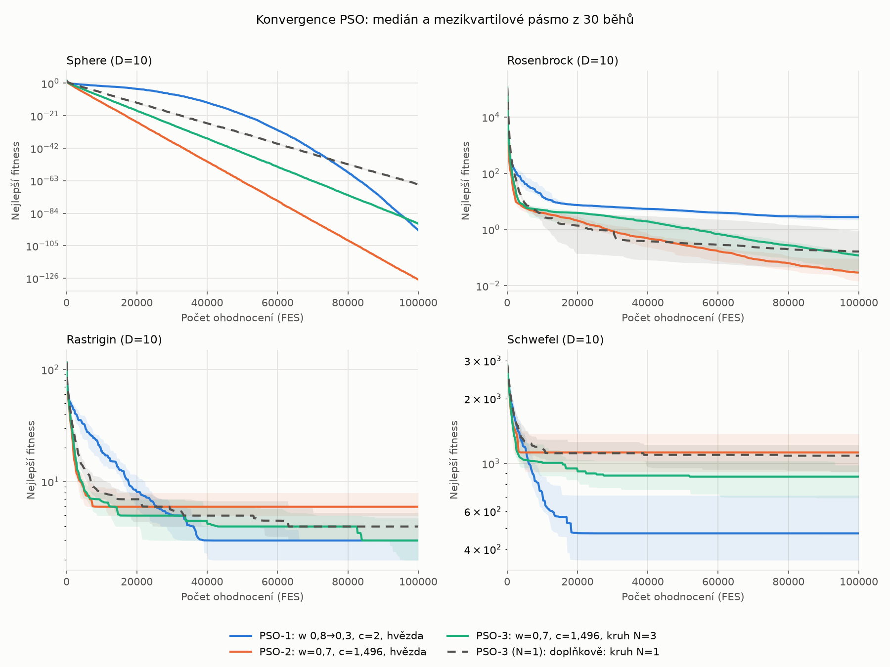
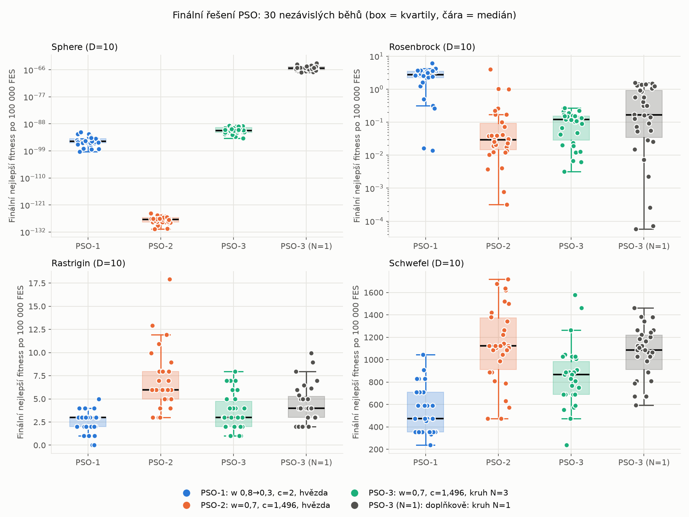
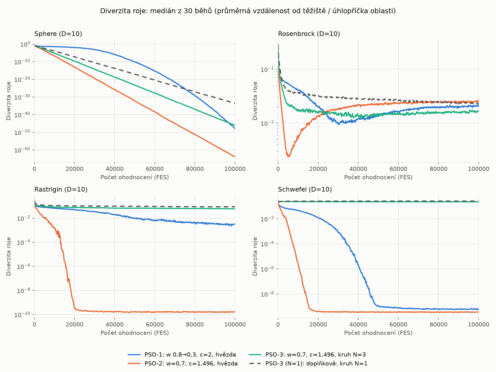
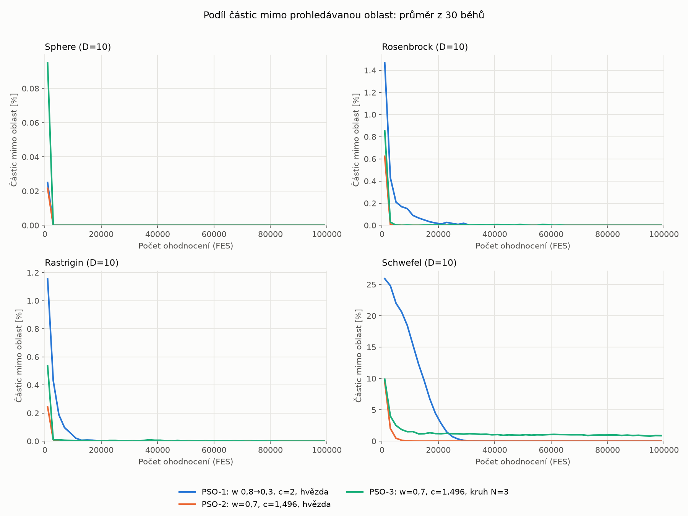
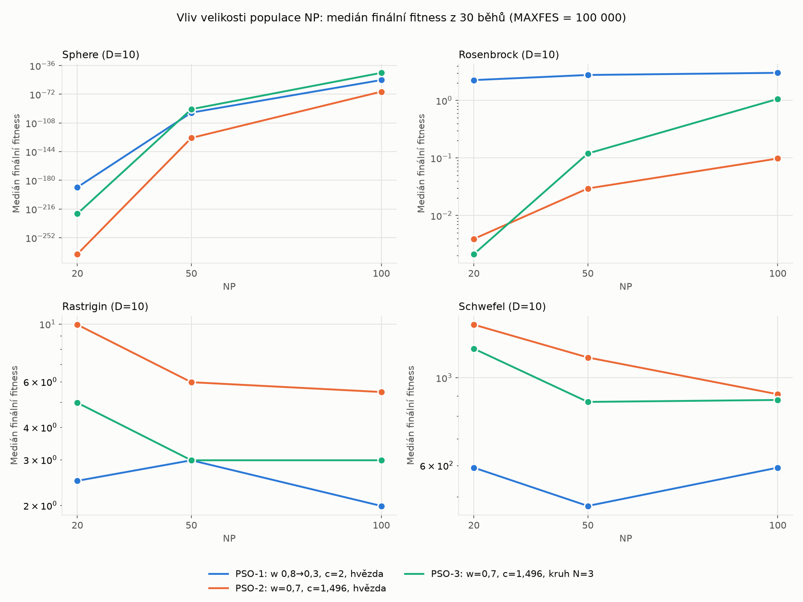

# Úkol 4 — PSO: lineárně klesající a konstantní setrvačnost, hvězda a kruh

## 1. Zadání
Implementovat tři verze algoritmu PSO (Particle Swarm Optimization) a otestovat je na
testovacích funkcích (minimalizace). Velikost populace NP volit v rozsahu 20–100,
ukončovací podmínkou je počet ohodnocení MAXFES.

| Varianta | Setrvačnost w                  | c₁ = c₂  | Topologie                    |
|----------|--------------------------------|----------|------------------------------|
| PSO-1    | lineárně klesá 0,8 → 0,3       | 2        | globální (hvězda)            |
| PSO-2    | konstantní 0,7                 | 1,49618  | globální (hvězda)            |
| PSO-3    | konstantní 0,7                 | 1,49618  | kruhová, velikost sousedství 3 |

U všech variant: v_max = 0,2 · Range, částice smí létat mimo prohledávanou oblast, ale
mimo ni se neohodnocují.

## 2. Teorie

### 2.1 Princip PSO
Roj NP částic se pohybuje prostorem ℝᴰ. Každá částice si pamatuje svou nejlepší dosud
navštívenou pozici **pBest** a přejímá informaci o nejlepší pozici **gBest** ze své
topologie. V každé iteraci (pro každou složku zvlášť):

```
v(i+1) = w · v(i) + c₁ · Rand · (pBest − x(i)) + c₂ · Rand · (gBest − x(i))
x(i+1) = x(i) + v(i+1)
```

- `Rand` je nezávislé U(0, 1) pro každou částici, složku i člen (kognitivní/sociální).
- v(0) = 0, počáteční pozice jsou rovnoměrně náhodné v prohledávané oblasti.
- Rychlost se omezuje na v_max = 0,2 · (horní mez − dolní mez) v každé složce.
- c₁ táhne částici k její vlastní nejlepší pozici (kognitivní složka), c₂ k nejlepší pozici
  v sousedství (sociální složka), w určuje, kolik z předchozí rychlosti zůstane.

### 2.2 Setrvačnost
- **PSO-1:** w klesá lineárně `w = w_start − (w_start − w_end) · i / n`, w_start = 0,8,
  w_end = 0,3 (slidy uvádějí 0,9 → 0,4, zadání 0,8 → 0,3). Vysoké w na začátku podporuje
  prohledávání celého prostoru (explorace), nízké na konci zjemňuje řešení (exploatace).
  V kódu se poměr i / n měří spotřebovanými ohodnoceními (FES / MAXFES). Pokud žádná částice
  neopustí oblast, je to totéž co iterace; když se část částic neohodnocuje, w přesto dojde
  přesně na 0,3 v okamžiku vyčerpání MAXFES.
- **PSO-2, PSO-3:** c₁ = c₂ = 1,49618 s w ≈ 0,7 je běžně používané nastavení odvozené z
  konstrikčního koeficientu (Clerc, Kennedy; původně w = 0,7298), zadání uvádí w = 0,7.

### 2.3 Topologie
- **Globální (hvězda):** všichni přejímají gBest z celé populace (nejlepší pBest roje).
- **Kruhová (velikost sousedství N):** informaci přejímá částice jen od N jedinců „vlevo"
  a N „vpravo" podle **ID** (ne podle pozice), indexy se berou modulo NP; částice je i sama
  součástí svého sousedství. Příklad ze slidu: ID 40, N = 2 → 38, 39, 41, 42.
  Informace o dobrém řešení se kruhem šíří pomaleji než u hvězdy, což zachovává
  diverzitu roje.

**Výklad „velikost sousedství 3".** Slidy definují velikost sousedství N jako počet sousedů
na *každé* straně, proto PSO-3 používá N = 3 (3 vlevo + 3 vpravo + sám = 7 částic).
Zadání ale lze číst i jako „jedinec + 2 sousedé" (N = 1), proto je v experimentu
**doplňkově** i varianta N = 1 (`PSO-3 (N=1)`); do tabulek se ale počítá zvlášť a hlavní
srovnání tří variant ze zadání se jí netýká.

### 2.4 Mimo prohledávanou oblast
Částice se pohybuje podle vzorců výše bez ohledu na meze. Pokud skončí mimo oblast, **není
ohodnocena** (nespotřebuje FES), její pBest se neaktualizuje a v dalších iteracích ji
táhnou zpět pBest a gBest, které vždy leží uvnitř oblasti.

## 3. Implementace ([pso.py](pso.py))
Python + NumPy, všechny operace vektorizované přes celý roj.

- `run_pso(func, low, high, variant, init_pos, rng)` – jádro pro všechny varianty; varianta
  je dána objektem `Variant(w_start, w_end, c1, c2, neighborhood)` (`neighborhood=None` =
  hvězda, jinak N pro kruh).
- `ring_neighbors` – indexy sousedství kruhu (modulo NP); `guide_positions` – gBest pro
  každou částici (globální nebo nejlepší pBest v sousedství).
- Aktualizace je synchronní: nejdřív se pohnou všechny částice, pak se ohodnotí ty uvnitř
  oblasti a aktualizují se pBest; gBest/lBest se z nich bere v další iteraci.
- Cyklus běží, dokud `fes < MAXFES`; v poslední iteraci se ohodnotí jen tolik částic, aby
  se MAXFES nepřekročilo (přesně MAXFES ohodnocení, ověřeno u každého běhu).
- `self_check()` – kontrola funkčnosti, spouští se vždy před experimentem (viz 4.1).

Spuštění (z adresáře `Ukol4`, trvá ~30 s):
```bash
../.venv/bin/python pso.py
```
Vytvoří `statistics.csv`, `significance.csv`, `convergence.png`, `final_boxplot.png`.

Doplňková analýza [analysis.py](analysis.py) (importuje `pso.py`, trvá ~3 min) měří diverzitu
roje a podíl částic mimo oblast v čase a testuje NP = 20, 50, 100; vytvoří `diversity.png`,
`outside_over_time.png`, `np_sweep.png`, `np_sweep.csv`:
```bash
../.venv/bin/python analysis.py
```

## 4. Experiment
- Funkce (D = 10, všechny mají minimum 0): **Sphere** [−5,12; 5,12] (unimodální),
  **Rosenbrock** [−5; 10] (úzké zakřivené údolí), **Rastrigin** [−5,12; 5,12] (mnoho
  pravidelných lokálních minim), **Schwefel** [−500; 500] (lokální minima daleko od
  globálního, optimum x = 420,97 leží blízko hranice).
- NP = 50, MAXFES = 100 000 (= 10 000 · D, 2 000 iterací bez částic mimo oblast),
  30 nezávislých běhů, seed 42.
- V každém běhu **všechny varianty startují ze stejné počáteční populace**, jinak jsou
  náhodné proudy nezávislé.
- „Cíl" = f ≤ 10⁻⁸; „FES do cíle" je průměr přes běhy, které cíl splnily.
- Statistické srovnání: Mann–Whitneyův U test (oboustranný, normální aproximace s opravou
  na shody) na finálních hodnotách f z 30 běhů, α = 0,05.

### 4.1 Kontrola funkčnosti
`self_check()` pro každou variantu (včetně N = 1) na Sphere s rozpočtem 5 000 FES ověřuje:

| Kontrola                                                         | Výsledek |
|------------------------------------------------------------------|----------|
| sousedství kruhu: ID 40, N = 2 → {38, 39, 40, 41, 42}; přetečení přes okraj (ID 0 a ID 9 v NP = 10) | OK |
| w(0) = 0,8; w(MAXFES/2) = 0,55; w(MAXFES) = 0,3; PSO-2/3 stále 0,7 | OK       |
| funkce je volána přesně MAXFES-krát (skutečně ohodnocené body)    | OK       |
| **žádný ohodnocený bod neleží mimo prohledávanou oblast**         | OK       |
| \|v\| ≤ v_max ve všech složkách a iteracích                       | OK       |
| nejlepší nalezená fitness nikdy nezhorší                          | OK       |
| částice mimo oblast se v testu opravdu vyskytují (pravidlo se uplatnilo) | OK  |

Navíc `main()` po experimentu ověří, že každý z 480 běhů spotřeboval přesně MAXFES ohodnocení.

### 4.2 Výsledky (finální nejlepší fitness po 100 000 FES, 30 běhů)

| Funkce     | Varianta      | best     | median  | mean    | std     | cíl 10⁻⁸ | FES do cíle | mimo oblast |
|------------|---------------|----------|---------|---------|---------|----------|-------------|-------------|
| Sphere     | PSO-1         | 4,8e-100 | 8,3e-96 | 2,0e-93 | 8,0e-93 | 30/30    | 31 833      | 0,00 %      |
| Sphere     | PSO-2         | 1,8e-131 | 1,4e-127| 2,0e-126| 6,3e-126| 30/30    | 6 560       | 0,00 %      |
| Sphere     | PSO-3         | 1,3e-94  | 1,7e-91 | 2,9e-90 | 5,2e-90 | 30/30    | 9 266       | 0,00 %      |
| Sphere     | *PSO-3 (N=1)* | 9,2e-68  | 5,3e-66 | 3,4e-65 | 9,8e-65 | 30/30    | 12 783      | 0,01 %      |
| Rosenbrock | PSO-1         | 1,4e-2   | 2,77    | 2,58    | 1,35    | 0/30     | –           | 0,06 %      |
| Rosenbrock | PSO-2         | 3,2e-4   | 0,029   | 0,25    | 0,74    | 0/30     | –           | 0,01 %      |
| Rosenbrock | PSO-3         | 3,2e-3   | 0,12    | 0,11    | 0,072   | 0/30     | –           | 0,02 %      |
| Rosenbrock | *PSO-3 (N=1)* | 5,8e-5   | 0,17    | 0,48    | 0,54    | 0/30     | –           | 0,03 %      |
| Rastrigin  | PSO-1         | 0        | 2,985   | 2,55    | 1,20    | 2/30     | 49 970      | 0,04 %      |
| Rastrigin  | PSO-2         | 2,985    | 5,97    | 6,97    | 3,18    | 0/30     | –           | 0,01 %      |
| Rastrigin  | PSO-3         | 0,995    | 2,985   | 3,52    | 1,99    | 0/30     | –           | 0,01 %      |
| Rastrigin  | *PSO-3 (N=1)* | 1,99     | 3,98    | 4,31    | 2,12    | 0/30     | –           | 0,03 %      |
| Schwefel   | PSO-1         | 237      | 474     | 542     | 203     | 0/30     | –           | 4,04 %      |
| Schwefel   | PSO-2         | 474      | 1 125   | 1 130   | 339     | 0/30     | –           | 0,27 %      |
| Schwefel   | PSO-3         | 237      | 869     | 855     | 266     | 0/30     | –           | 1,36 %      |
| Schwefel   | *PSO-3 (N=1)* | 592      | 1 086   | 1 059   | 228     | 0/30     | –           | 1,13 %      |

*Kurzívou* je doplňková varianta mimo zadání. „Mimo oblast" je podíl pozic částic (přes
všechny iterace a běhy), které skončily mimo prohledávanou oblast a nebyly ohodnoceny.
Úplná data: [statistics.csv](statistics.csv).

### 4.3 Statistické srovnání (Mann–Whitney, finální fitness)
Tabulka uvádí p-hodnoty po **Holmově korekci** na vícenásobné testování přes všech 16 testů
(tučně p < 0,05). V závorce je varianta s nižším mediánem.

| Funkce     | PSO-1 vs PSO-2   | PSO-1 vs PSO-3   | PSO-2 vs PSO-3   | PSO-3 vs N = 1   |
|------------|------------------|------------------|------------------|------------------|
| Sphere     | **4,8e-10** (2)  | **3,1e-9** (1)   | **4,8e-10** (2)  | **4,8e-10** (N=3) |
| Rosenbrock | **3,3e-7** (2)   | **4,2e-8** (3)   | 0,21 (2)         | 0,21 (N=3)       |
| Rastrigin  | **1,4e-8** (1)   | 0,21 (shodné mediány) | **6,9e-5** (3) | 0,21 (N=3)    |
| Schwefel   | **1,6e-7** (1)   | **1,0e-4** (1)   | **0,005** (3)    | **0,007** (N=3)  |

Všechny rozdíly, které byly průkazné bez korekce, zůstávají průkazné i po ní; neprůkazné
(Rosenbrock PSO-2 vs PSO-3, Rastrigin PSO-1 vs PSO-3, N = 3 vs N = 1 na Rosenbrocku a
Rastriginu) zůstávají neprůkazné. Nekorigované p-hodnoty jsou v
[significance.csv](significance.csv) (sloupce `p_value` a `p_holm`).

### 4.4 Grafy
Medián a mezikvartilové pásmo nejlepší fitness přes FES (logaritmická osa):



Rozdělení finálních hodnot z 30 běhů (jednotlivé běhy jako body; Sphere a Rosenbrock
logaritmicky, Rastrigin a Schwefel lineárně):



### 4.5 Diverzita roje
Diverzita = průměrná vzdálenost částic od těžiště roje vydělená úhlopříčkou prohledávané
oblasti (0 = všechny částice v jednom bodě). Medián z 30 běhů:

| Funkce     | Varianta      | 20 000 FES | 100 000 FES |
|------------|---------------|------------|-------------|
| Rastrigin  | PSO-1         | 0,051      | 0,0031      |
| Rastrigin  | PSO-2         | 4e-10      | 1,6e-10     |
| Rastrigin  | PSO-3         | 0,079      | 0,060       |
| Rastrigin  | *PSO-3 (N=1)* | 0,10       | 0,086       |
| Schwefel   | PSO-1         | 0,012      | 6,1e-10     |
| Schwefel   | PSO-2         | 4e-10      | 3,7e-10     |
| Schwefel   | PSO-3         | 0,23       | 0,22        |
| Schwefel   | *PSO-3 (N=1)* | 0,25       | 0,26        |

(Sphere: všechny varianty klesají exponenciálně, PSO-2 nejrychleji; Rosenbrock: všechny
kolem 0,02, viz graf.)



### 4.6 Částice mimo oblast v čase
Průměrný podíl částic mimo oblast, v prvních 2 000 FES / ve zbytku běhu (20 000–100 000 FES):

| Funkce     | PSO-1           | PSO-2           | PSO-3           |
|------------|-----------------|-----------------|-----------------|
| Sphere     | 0,03 % / 0 %    | 0,02 % / 0 %    | 0,10 % / 0 %    |
| Rosenbrock | 1,47 % / 0,002 %| 0,62 % / 0 %    | 0,85 % / 0,002 %|
| Rastrigin  | 1,16 % / 0 %    | 0,25 % / 0 %    | 0,54 % / 0,002 %|
| Schwefel   | **25,9 %** / 0,14 % | 9,5 % / 0 % | 9,9 % / **1,0 %** |



### 4.7 Vliv velikosti populace NP
Stejný experiment (MAXFES = 100 000, 30 běhů, stejné seedy) pro NP = 20, 50 a 100.
Medián finální fitness (úplná data včetně průměru a std: [np_sweep.csv](np_sweep.csv)):

| Funkce     | Varianta | NP = 20    | NP = 50    | NP = 100   |
|------------|----------|------------|------------|------------|
| Sphere     | PSO-1    | 1,8e-189   | 8,3e-96    | 6,6e-55    |
| Sphere     | PSO-2    | 2,4e-273   | 1,4e-127   | 1,8e-69    |
| Sphere     | PSO-3    | 1,1e-222   | 1,7e-91    | 7,2e-46    |
| Rosenbrock | PSO-1    | 2,26       | 2,77       | 3,02       |
| Rosenbrock | PSO-2    | 0,0039     | 0,029      | 0,098      |
| Rosenbrock | PSO-3    | 0,0021     | 0,12       | 1,06       |
| Rastrigin  | PSO-1    | 2,49       | 2,98       | 1,99       |
| Rastrigin  | PSO-2    | 9,95       | 5,97       | 5,47       |
| Rastrigin  | PSO-3    | 4,97       | 2,98       | 2,98       |
| Schwefel   | PSO-1    | 592        | 474        | 592        |
| Schwefel   | PSO-2    | 1 362      | 1 125      | 908        |
| Schwefel   | PSO-3    | 1 184      | 869        | 878        |



## 5. Vyhodnocení

**Žádná varianta nevyhrává všude; pořadí závisí na typu funkce.**

**Unimodální Sphere: nejlepší PSO-2.** Dosáhne cíle 10⁻⁸ po 6 560 FES (PSO-3 po 9 266,
PSO-1 po 31 833) a má i nejlepší finální hodnotu (medián 10⁻¹²⁷ proti 10⁻⁹⁶ u PSO-1 a
10⁻⁹¹ u PSO-3, všechny rozdíly p < 10⁻⁹). Hvězda s konstantním w předává nejlepší
řešení všem okamžitě, takže roj se na jednoduché funkci stahuje nejrychleji. PSO-1 je
zpočátku nejpomalejší (vysoké w), ale jeho křivka se na konci strmě láme dolů, jakmile w
klesne k 0,3, a ve finále předběhne PSO-3 (medián 8,3e-96 proti 1,7e-91).

**Rosenbrock: PSO-2 a PSO-3, PSO-1 je nejhorší.** Medián PSO-1 je 2,77, zatímco PSO-2 má
0,029 a PSO-3 0,12 (p < 10⁻⁷). Mezi PSO-2 a PSO-3 rozdíl není statisticky průkazný
(p = 0,088). PSO-2 má nejnižší medián, ale také tři odlehlé běhy (0,99; 1,04 a 3,99; průměr
0,25 při mediánu 0,029), takže jeho výsledky jsou rozptýlenější než u PSO-3, kde žádný běh
nepřesáhl 0,27 (std 0,74 proti 0,072). Žádná varianta nedosáhla cíle 10⁻⁸.

**Multimodální Rastrigin a Schwefel: kruh a PSO-1 jsou lepší než hvězda.** Při stejných
parametrech (w = 0,7, c = 1,49618) je kruh průkazně lepší než hvězda na Rastriginu
(medián 2,985 proti 5,97, p = 9e-6) i na Schwefelu (869 proti 1 125, p = 8e-4). Nejlépe
vychází PSO-1: na Schwefelu je s mediánem 474 průkazně lepší než PSO-2 i PSO-3
(p < 2e-5), na Rastriginu stejně dobrý jako PSO-3 (shodné mediány 2,985, p = 0,053) a jako
jediný dosáhl globálního optima 0 (ve 2 z 30 běhů). Výsledek hvězda vs kruh odpovídá
obvyklému kompromisu: **hvězda konverguje rychle, ale na multimodálních funkcích častěji
uvízne v lokálním minimu; kruh šíří informaci pomaleji a déle zachovává diverzitu**, za cenu
pomalejší konvergence na Sphere (9 266 vs 6 560 FES do cíle). Diverzita roje (4.5) to
potvrzuje: na Rastriginu a Schwefelu se roj PSO-2 stáhne prakticky do jednoho bodu
(diverzita ≈ 4e-10 už při 20 000 FES, tedy v pětině rozpočtu) a dál se nezlepšuje, zatímco
kruh si diverzitu drží po celý běh (Schwefel 0,22; Rastrigin 0,06). U PSO-1 klesá diverzita
později a pomaleji (Schwefel 6e-10 až kolem 50 000 FES), což zhruba odpovídá jeho lepším
výsledkům na těchto funkcích oproti PSO-2.

**Podoba chyby na Rastriginu a Schwefelu.** Obě funkce jsou separabilní, takže chyba je
součet „cen" souřadnic, které uvízly v lokálním minimu. Na Rastriginu jsou finální hodnoty
násobky ≈ 0,995 (nejbližší minimum x = ±1 stojí 0,995 na souřadnici), medián 2,985 tedy
znamená tři souřadnice uvízlé v ±1. Na Schwefelu nejbližší lokální minimum x = −302,5 stojí
118,44 na souřadnici; nejlepší hodnota 237 = 2 × 118,44 a medián PSO-1 474 = 4 × 118,44.
(Výpočet hodnot lokálních minim jednorozměrných funkcí a kontrola na 10 doplňkových bězích
PSO-1, kde všechny finální hodnoty vyšly jako celočíselné násobky 118,44, proběhly
mimo `pso.py`; PSO-2 a PSO-3 končí i v dalších minimech, např. x = 203,8 s 217,1.)

**Pravidlo „létat mimo oblast".** Celkově opouští oblast zanedbatelný podíl pozic (≤ 0,06 %),
jen na Schwefelu je to znatelné (PSO-1 4,0 %, PSO-3 1,4 %, PSO-2 0,3 %). Časový průběh (4.6)
ukazuje, že za to jsou dvě různé příčiny. **PSO-1 vylétá hlavně na začátku:** v prvních
2 000 FES je mimo oblast 25,9 % částic na Schwefelu (PSO-2 9,5 %, PSO-3 9,9 %), na Rosenbrocku
1,47 % (0,62 %, 0,85 %) a na Rastriginu 1,16 % (0,25 %, 0,54 %), a s klesajícím w se podíl
během ~30 000 FES vytratí. To je v souladu s teorií stability: pro c₁ + c₂ = 4 leží PSO-1
mimo oblast stability druhého řádu `c₁ + c₂ < 24 (1 − w²) / (7 − 5w)` (pro w = 0,8 je mez 2,88,
pro w = 0,3 jen 3,97), takže rychlosti omezuje hlavně v_max, zatímco PSO-2/3 (součet 2,99 při
mezi 3,50) jsou stabilní. (Na Sphere je podíl u všech variant zanedbatelný, ≤ 0,1 % v prvních
2 000 FES, a PSO-1 tam není nejvyšší.) **PSO-3 na Schwefelu naopak vylétá trvale,** přibližně
1 % částic po celý zbytek běhu, protože se roj kruhu nikdy nestáhne (diverzita 0,22). Že je za
to také blízkost optima x ≈ 421 k hranici 500, jsem nezkoumal.

**Doplňková varianta N = 1** je na všech funkcích horší nebo srovnatelná s N = 3: průkazně
horší na Sphere (medián 5,3e-66 proti 1,7e-91) a na Schwefelu (1 086 proti 869,
p = 0,001), na Rosenbrocku a Rastriginu rozdíl průkazný není (p = 0,068 a 0,12). Menší
sousedství tedy v tomto nastavení nepřineslo zlepšení u multimodálních funkcí, ačkoli
diverzita N = 1 je nejvyšší (Schwefel 0,26, Rastrigin 0,086): sama vysoká diverzita
kvalitu výsledku nezaručuje. Proč N = 1 vychází hůř, jsem nezkoumal.

**Vliv NP (4.7).** Hlavní závěry platí i pro NP = 20 a 100 (srovnání jen podle mediánů, bez
statistických testů): PSO-1 je nejhorší na Rosenbrocku (2,3–3,0 proti ≤ 1,1) a nejlepší na
Schwefelu (474–592 proti ≥ 869) při všech NP; PSO-2 je nejlepší na Sphere při všech NP; kruh
je lepší než hvězda na Rastriginu při všech NP (např. NP = 100: 2,98 proti 5,47) a na Schwefelu
při NP = 20 a 50, při NP = 100 jsou téměř shodné (878 proti 908). Pořadí PSO-2 vs PSO-3 na
Rosenbrocku na NP závisí (NP = 20: PSO-3 0,0021 < PSO-2 0,0039; NP = 100: PSO-2 0,098 <
PSO-3 1,06), což je v souladu s neprůkazným rozdílem při NP = 50. Při pevném MAXFES vychází na
Sphere a Rosenbrocku (PSO-2, PSO-3) lépe menší NP, protože se stihne víc iterací; na
Rastriginu a Schwefelu naopak PSO-2 těží z větší populace (Rastrigin 9,95 → 5,47,
Schwefel 1 362 → 908). Pořadí variant se tedy mezi NP zásadně nemění (kromě PSO-2 vs PSO-3
na Rosenbrocku), ale NP = 50 nebylo vždy nejlepší volbou; optimální NP závisí na funkci a variantě.

**Shrnutí – pořadí podle mediánu finální fitness** (1. = nejlepší; shoda = rozdíl
neprůkazný nebo shodné mediány):

| Varianta | Sphere | Rosenbrock | Rastrigin    | Schwefel |
|----------|--------|------------|--------------|----------|
| PSO-1    | 2.     | 3.         | 1.–2. (shoda)| 1.       |
| PSO-2    | 1.     | 1. (neprůkazně před PSO-3) | 3. | 3. |
| PSO-3    | 3.     | 2.         | 1.–2. (shoda)| 2.       |

Žádná varianta není nejlepší všude. PSO-2 vyhrává na Sphere a Rosenbrocku, ale je nejhorší
na obou multimodálních funkcích; PSO-1 je nejlepší na multimodálních funkcích, ale nejhorší
na Rosenbrocku a pomalá na Sphere. PSO-3 je na třech funkcích ze čtyř druhá nebo sdílí první
místo a poslední je jen na Sphere, kde i tak dosahuje ≈ 10⁻⁹¹. Doporučení: na hladké
unimodální úlohy PSO-2, na multimodální PSO-1 nebo PSO-3, jako kompromis bez znalosti úlohy
PSO-3. Závěr o kompromisu vychází jen z těchto čtyř funkcí a jedné dimenze.

## 6. Omezení
- Parametry (w, c₁, c₂) jsou dány zadáním, NP = 50 bylo zvoleno bez ladění; citlivost na NP
  je ověřena jen podle mediánů pro NP = 20 a 100 (4.7), bez testů. Dimenze D = 10 je jediná.
- Testováno 16 párů s Holmovou korekcí (4.3). Mann–Whitney používá normální aproximaci;
  na Rastriginu jsou hodnoty diskrétní (násobky ≈ 0,995) a mnoho shod.
- Výsledky na Rosenbrocku mají u PSO-2 a doplňkové varianty N = 1 odlehlé běhy; střední
  hodnota se proto liší od mediánu a zvolený 30běhový vzorek může pořadí PSO-2 vs PSO-3
  (p = 0,088) nerozhodnout.
- „Velikost sousedství 3" je vyložena podle slidů jako N = 3 na každé straně (viz 2.3);
  výklad „jedinec + 2 sousedé" je jen doplňkově.
- Schwefel používá přesnou konstantu 418,982887… (minimum 0); v Ukolu 2 byla zaokrouhlena
  na 418,9829, takže tamní čísla nejsou přímo srovnatelná.
- V poslední iteraci se při překročení MAXFES ohodnotí jen částice s nejnižším ID z těch,
  které jsou uvnitř oblasti; vliv na výsledek je zanedbatelný (nejvýš jedna iterace).
- Diverzita roje a podíl částic mimo oblast jsou změřeny (4.5, 4.6), ale souvislost se
  stabilitou PSO-1 a důvod, proč N = 1 nevychází lépe než N = 3, jsou úvahy, ne přímo
  ověřená tvrzení. Diverzita je měřena včetně částic mimo oblast.
